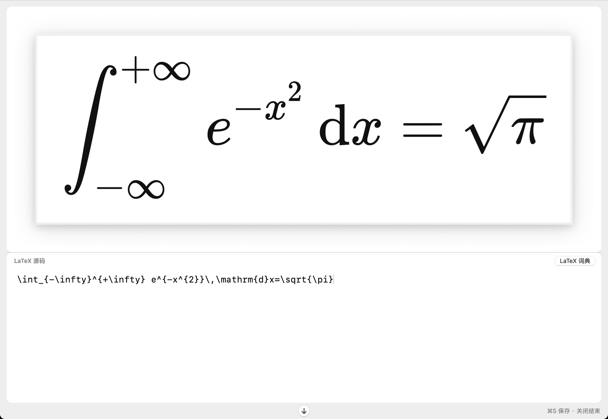
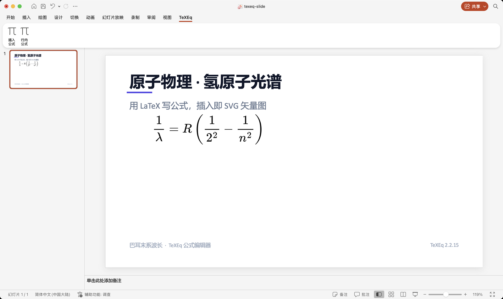
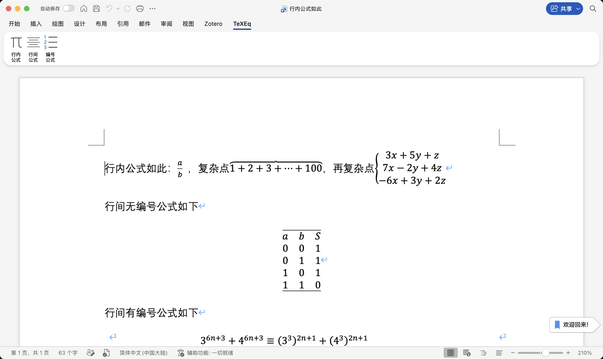
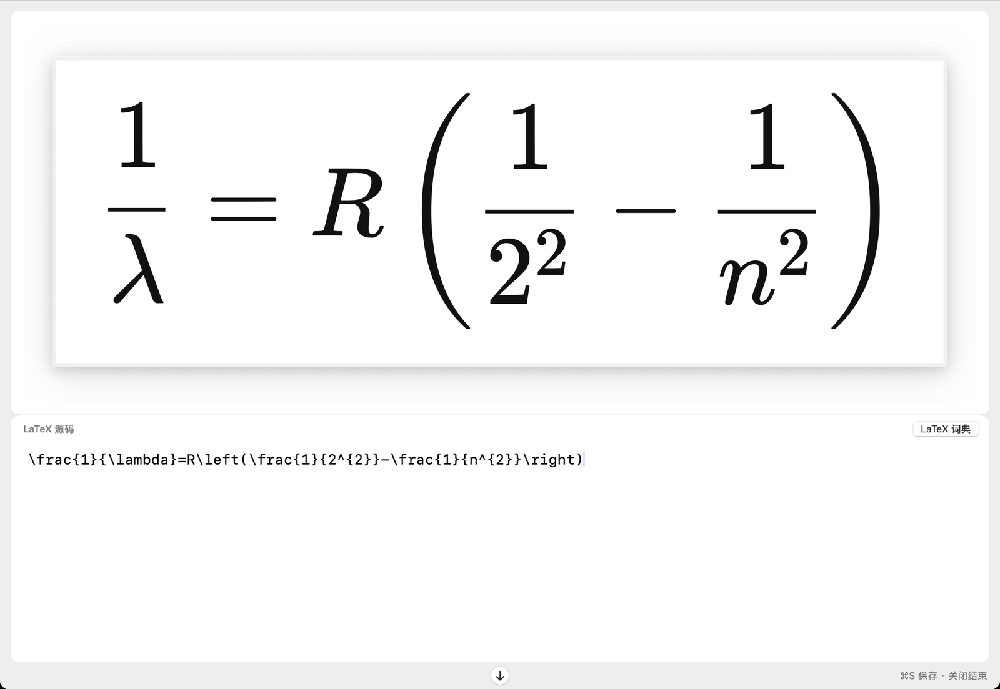
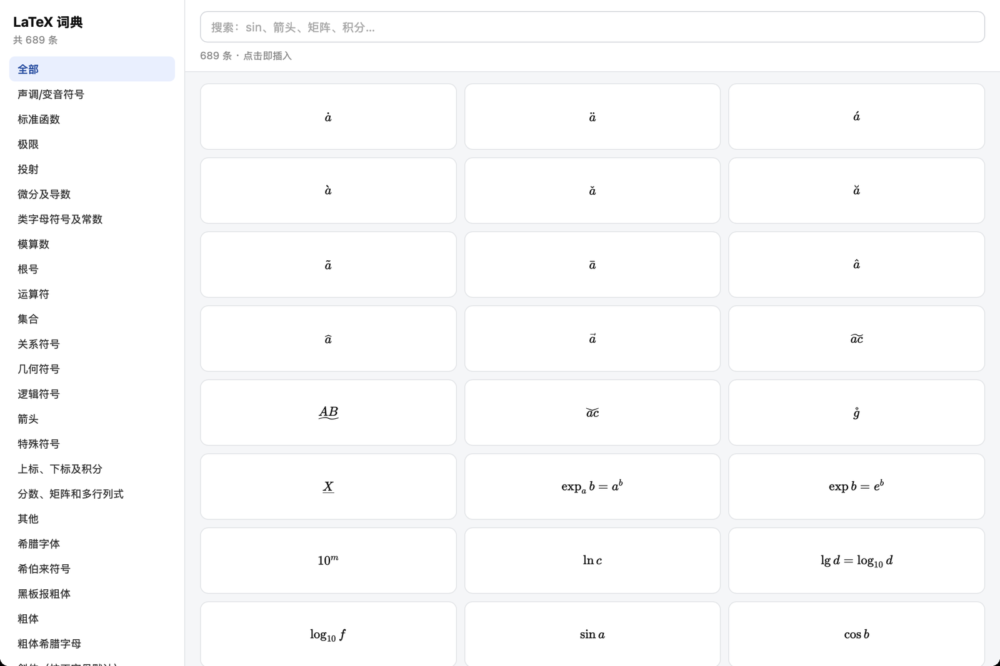

# TeXEq

**A MathType / AxMath-style equation editor, built for Microsoft Office on macOS.**

**Switch to Mac. Keep your equations.**

[English](README.md) · [简体中文](README.zh-CN.md)

`macOS 15+` · `Apple silicon` · `PowerPoint + Word` · `LaTeX` · `real SVG` · `no TeX install`

[Official website & download](https://texeq.rancholab.cn) · [Releases](https://github.com/Rancho-123/texeq/releases/latest) · [Issues](https://github.com/Rancho-123/texeq/issues)

TeXEq is a lightweight, native equation editor for **Microsoft PowerPoint and Word on macOS**. It brings a familiar MathType / AxMath-style workflow to the Mac: LaTeX editing with live preview, true SVG vector output in PowerPoint, double-click editing that keeps the LaTeX source, and migration of compatible legacy equation objects.

Whether you are preparing lecture slides, writing papers, building teaching materials, or moving years of Office documents from Windows to a Mac, TeXEq keeps your equations editable.

**No Windows VM. No TeX distribution. Install and start writing.**

## Why TeXEq

Many researchers and educators rely on MathType or AxMath for equation editing in Microsoft Office. Moving to macOS often means losing that familiar workflow — or being unable to edit the equations already inside existing documents.

TeXEq bridges that gap: a familiar MathType / AxMath-style editing experience, modern LaTeX rendering, and native Microsoft Office integration on the Mac.

## Highlights

### 1. Built for Microsoft Word & PowerPoint on Mac

- Adds a dedicated **TeXEq** tab to the Office ribbon.
- Insert and edit equations without leaving Office and without a Windows VM.
- Works directly inside your existing `.pptx` and `.docx` files.
- Intended for lecture slides, academic papers, teaching materials, exam papers and technical reports.

### 2. Bring your MathType / AxMath equations to the Mac

**Your existing equations deserve a second life.**

- Double-click supported legacy MathType / AxMath OLE equation objects in Office.
- TeXEq attempts to read the TeX / LaTeX source stored inside the object, opens it in the editor, and can replace it in place with an editable equation.
- The replacement keeps the original position, size, rotation and z-order as closely as possible.
- If conversion fails, the original object is left untouched.

> **Compatibility note:** conversion requires the legacy object to keep extractable TeX / LaTeX information. Image-only equations, screenshots and unsupported objects cannot be reconstructed. TeXEq does not promise to open every legacy equation.

### 3. True SVG vector equations in PowerPoint

- Inserts real SVG graphics (Office "graphic" objects) in supported PowerPoint versions — not screenshots.
- Stays sharp at any zoom level, on projectors, in print and in screenshots.
- Glyphs are stored as vector paths, so recipients do not need special math fonts installed.
- Supported by Office 2019 and Microsoft 365; older Office versions fall back to a high-resolution bitmap.
- Can be converted to shapes with Office's built-in **Convert to Shape**.

### 4. Double-click to edit

- TeXEq stores the LaTeX source with the equation.
- Double-click a TeXEq equation to reopen it with its source; close the editor and the equation is replaced in place.
- No re-inserting, no re-aligning, no repositioning.
- Works for PowerPoint equations and for Word equations created with TeXEq.

### 5. Live LaTeX editing

- LaTeX source and live typeset preview in the same window, powered by the built-in KaTeX engine.
- Immediate feedback on fractions, roots, integrals, sums, matrices, piecewise functions and multi-line equations.
- Supports colored equations and common mathematical structures.
- Everything renders locally; nothing is uploaded.

### 6. Three equation styles in Word

- **Inline** — flows naturally with the text.
- **Display** — stands alone for derivations.
- **Numbered** — for papers, textbooks and exams.
- Uses Word-native equation objects, so Word's own layout engine keeps working.

### 7. Built-in LaTeX dictionary

- **689 entries in 29 categories**: symbols, functions, operators, sets, arrows, matrices, Greek letters and more.
- Search by keyword, then click to insert at the cursor.
- Fully offline — no need to look commands up on the web.

### 8. Lightweight, offline and privacy-friendly

- Built-in KaTeX engine: no MacTeX or BasicTeX, no multi-gigabyte TeX installation.
- The installer is about 4 MB.
- Equation editing, rendering and write-back happen on your Mac.
- No upload of equation or document content. The license server only validates activation codes and a machine hash.
- Offline editing and rendering.

## Screenshots

| PowerPoint | Word |
| --- | --- |
|  |  |
| SVG vector equations, double-click to edit | Inline, display and numbered equations |

| Editor | LaTeX dictionary |
| --- | --- |
|  |  |
| Live preview + LaTeX source | 689 searchable symbols and functions |

## Compatibility

| Component | Requirement |
| --- | --- |
| Operating system | macOS 15 or later |
| Processor | Apple silicon (arm64). Intel Macs are not supported yet. |
| PowerPoint | Microsoft Office 2019, 2021, Microsoft 365 (desktop) |
| Word | Microsoft Office 2019, 2021, Microsoft 365 (desktop) |
| Equation engine | Built-in KaTeX |
| Internet | Not required for equation editing or rendering |
| Installer | Not signed or notarized by Apple — see [Install](docs/INSTALL.md) |

TeXEq supports the common mathematical LaTeX syntax supported by KaTeX. TikZ, PSTricks, some advanced packages and complex chemistry notation are not supported. Windows, WPS Office and Office for the web are not supported.

## Download & install

1. Download the latest `TeXEq-*-katex-arm64.pkg` from [Releases](https://github.com/Rancho-123/texeq/releases/latest) (or from the [official website](https://texeq.rancholab.cn/#download)).
2. Verify the checksum (recommended): `shasum -a 256 TeXEq-*-katex-arm64.pkg` must match the value in the release notes.
3. Double-click the package and install (administrator password required).
4. The installer is not notarized by Apple. If macOS blocks it, right-click the `.pkg` → **Open**, or go to **System Settings → Privacy & Security** and click **Open Anyway**.
5. On first launch, grant **Accessibility** permission (System Settings → Privacy & Security → Accessibility → enable TeXEq). TeXEq needs it to receive double-click events from Office.
6. Open PowerPoint or Word — the **TeXEq** tab appears in the ribbon.

Full step-by-step guide: [docs/INSTALL.md](docs/INSTALL.md).

## Trial & licensing

- Free download. The first launch starts a **7-day full-feature trial** — no registration, no account.
- After the trial, a license is required to insert or edit equations. Existing equations remain visible, printable and presentable.
- Each license covers **2 Macs**; device transfer is supported.
- Licenses are obtained through the official website (one-time contribution, no subscription).
- Current terms: [official FAQ](https://texeq.rancholab.cn/#faq).

## FAQ

**Is it free?**
Free to download, with a 7-day full-feature trial. Continued editing after the trial requires a license.

**Can it open every old MathType / AxMath equation?**
No. TeXEq can convert legacy objects that still store TeX / LaTeX source. Image-only equations cannot be reverse-engineered, and the original object is left intact if conversion fails.

**Will it conflict with MathType?**
No. TeXEq is an independent Office add-in and editor. It does not replace MathType and does not modify MathType objects unless you explicitly double-click one.

**Does it work with WPS or Office for the web?**
No. TeXEq supports the desktop Microsoft PowerPoint and Word applications on macOS.

**Do I need MacTeX / BasicTeX?**
No. The KaTeX engine is built in.

**Is my document uploaded?**
No. Editing, rendering and write-back are local. The license server only handles activation codes and a machine hash.

**Intel Mac?**
Not supported yet; macOS 15 + Apple silicon only.

## Who is TeXEq for?

- **Researchers** — papers, reports and complex mathematical expressions.
- **University teachers** — lecture slides, handouts and course notes.
- **School teachers** — math, physics and chemistry exam papers.
- **Students** — assignments, theses and reports.
- **MathType / AxMath users** — keep a familiar workflow on macOS and migrate compatible equations.
- **LaTeX users** — write LaTeX inside Word and PowerPoint.

## About this repository

This repository is a **distribution and support channel**: it hosts installers (Releases), screenshots, documentation and issue tracking.

- **TeXEq is closed-source, proprietary software.** No source code is provided and this repository is not an open-source project.
- The installer is free to download and includes a 7-day full-feature trial.
- See [LICENSE.md](LICENSE.md) and the [EULA](https://texeq.rancholab.cn/legal.html).
- Feedback: open an [issue](https://github.com/Rancho-123/texeq/issues) or use the in-app **Feedback & Suggestions** entry.

## Links

- Website: <https://texeq.rancholab.cn>
- Download: <https://texeq.rancholab.cn/#download>
- Changelog: [CHANGELOG.md](CHANGELOG.md)
- EULA & privacy: <https://texeq.rancholab.cn/legal.html>
- Email: <wangyu_1899@126.com>

---

*TeXEq is an independent product. It is not affiliated with or endorsed by MathType or AxMath. MathType and AxMath are trademarks of their respective owners.*
