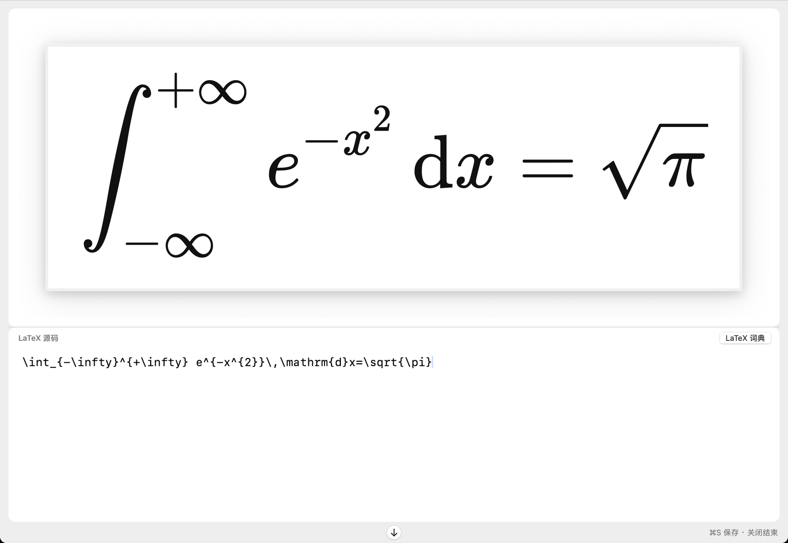
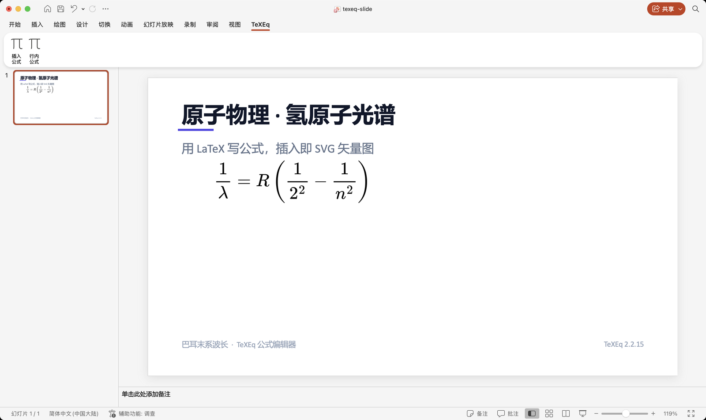
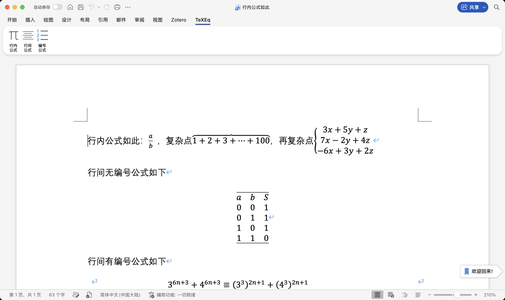
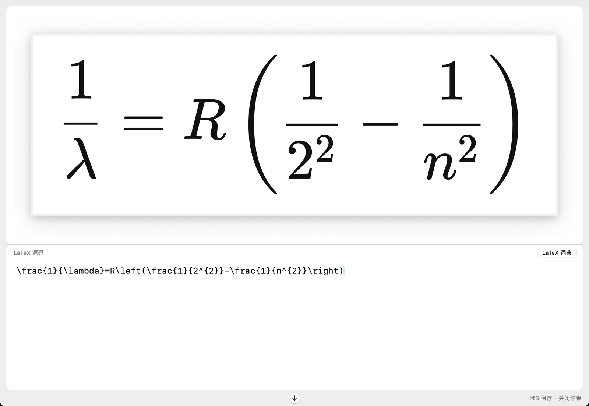
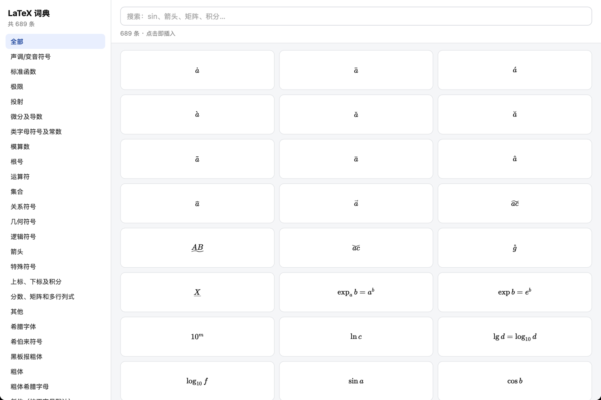
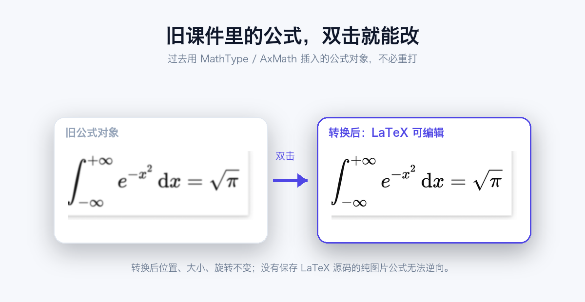

# TeXEq

### 专为 macOS 版 Word / PowerPoint 打造的专业公式编辑器

**熟悉 MathType / AxMath 的操作体验，专为 Mac 重新打造。**

**换 Mac，不必从头重写每一个公式。**

[English](README.md) · [简体中文](README.zh-CN.md)

`macOS 15+` · `Apple 芯片` · `PowerPoint + Word` · `LaTeX` · `SVG 矢量` · `免装 TeX`

[官方网站与下载](https://texeq.rancholab.cn) · [下载最新版](https://github.com/Rancho-123/texeq/releases/latest) · [问题反馈](https://github.com/Rancho-123/texeq/issues)

TeXEq 是一款专为 macOS 开发的轻量级数学公式编辑器，深度适配 **Microsoft PowerPoint 和 Word**，为熟悉 MathType、AxMath 的用户提供自然的公式编辑体验。

它把 LaTeX 实时排版、SVG 矢量输出、公式双击编辑与旧公式迁移整合到同一工作流程中，让科研人员、教师和学生能够在 Mac 上更轻松地制作课件、撰写论文、编辑数学文档。

**无需 Windows 虚拟机，无需安装庞大的 TeX 环境，安装即可使用。**

## 为什么选择 TeXEq

对于长期使用 MathType 或 AxMath 的用户而言，从 Windows 转向 Mac，最大的困难之一往往不是更换电脑，而是熟悉的公式编辑工作流程难以延续。

尤其是已经积累多年的教学课件、科研报告和数学文档，往往包含大量旧公式。重新录入不仅耗费时间，还可能破坏原有排版。

**TeXEq 正是为解决这些问题而开发。**

它不仅让 Mac 版 Office 拥有熟悉的公式编辑入口，还支持对符合条件的 MathType / AxMath 旧公式进行直接读取与原位转换，让旧文档的继续编辑变得更加容易。

## 核心功能与亮点

### 1. 专为 Mac 版 Office 设计

TeXEq 直接集成到 macOS 版 Microsoft PowerPoint 和 Word 中。

- 提供独立的 **TeXEq** 功能选项卡。
- 无需切换 Windows 或使用虚拟机。
- 在 Office 中直接插入、修改和管理公式。
- 适合科研论文、学术报告、教学课件、试卷和技术文档。

### 2. 兼容 MathType / AxMath 旧公式，降低换机迁移成本

**旧课件不必重做，旧公式不必全部重写。**

TeXEq 支持识别和转换符合条件的 MathType、AxMath 等传统 OLE 公式对象。

- 双击旧公式，尝试读取其保存的 TeX / LaTeX 信息。
- 在 TeXEq 中打开并继续编辑。
- 转换为现代公式对象，无需重新输入整条公式。
- 尽可能保留原有位置、大小、旋转角度及层级。
- 转换失败时保留旧对象，避免破坏文档。

> **特别说明：** 旧公式的转换依赖原对象中是否保存了可提取的 TeX / LaTeX 信息。纯图片或缺少有效源码的对象无法自动还原，并非所有旧公式都能保证转换成功。

### 3. SVG 矢量公式，放大依然清晰

TeXEq 在支持的 PowerPoint 版本中直接插入真正的 SVG 矢量图形，而不是简单的公式截图。

- 放大不失真，适合大屏投影和课堂展示。
- 高质量数学排版，适合科研与教学场景。
- 公式字形以矢量路径保存，减少对目标电脑字体的依赖。
- 支持 Office 原生矢量图形处理功能，可「转换为形状」。
- Office 2019 / Microsoft 365 原生支持；更旧的版本自动回退为高清位图。

### 4. 双击即可编辑，无需重新排版

使用 TeXEq 创建的公式能够保留对应的 LaTeX 源码。

- 需要修改时，双击即可重新进入编辑器。
- 修改完成后，公式自动写回原位置。
- 无需反复复制、删除、重新插入，也不必每次重新调整大小和位置。
- PowerPoint 公式与 TeXEq 创建的 Word 公式都支持。

### 5. LaTeX 实时预览，编辑更加直观

TeXEq 内置 KaTeX 数学排版引擎，实现 LaTeX 源码与公式预览同屏显示。

- 输入过程中实时显示排版效果。
- 支持分数、根号、积分、求和及上下标。
- 支持矩阵、分段函数、多行对齐等复杂结构。
- 支持彩色公式与常用数学表达式。
- 关闭编辑窗口即可自动同步回 Office。

### 6. 完整适配 Word 常用公式场景

针对 Word 的科研写作与教学排版需求，TeXEq 支持三种公式插入模式。

- **行内公式：** 与文字自然衔接，适合论文正文和教学讲义。
- **行间公式：** 独立展示复杂公式及推导过程。
- **编号公式：** 适合科研论文、教材和技术文档。

Word 中插入的公式采用原生公式对象，能够继续参与 Word 的正常排版。

### 7. 内置 689 条 LaTeX 公式与符号词典

TeXEq 内置覆盖 **29 个类别、689 条条目** 的 LaTeX 词典，包括常见数学符号、函数、集合、箭头、矩阵、希腊字母等内容。

- 支持关键词搜索、浏览与点击插入。
- 不必反复查找和记忆复杂命令。
- 完全离线，不依赖网络。

### 8. 轻量化、离线可用，保护文档隐私

- 内置 KaTeX 引擎，无需安装 MacTeX / BasicTeX。
- 安装包约 **4 MB**，轻量易部署。
- 公式编辑、渲染及写回均在本机完成。
- 无需将公式或文档内容上传到服务器；授权服务只校验激活码与机器码。
- 支持离线编辑，适合未发表论文及内部科研资料。

## 实际使用效果

| PowerPoint 公式编辑 | Word 行内 / 行间 / 编号公式 |
| --- | --- |
|  |  |
| SVG 矢量公式，适合课堂演示与科研报告 | 三种插入方式，适合论文与讲义 |

| 编辑器 | LaTeX 词典 |
| --- | --- |
|  |  |
| 源码与预览同屏 | 689 条符号与函数，可搜索插入 |

## 系统兼容性

| 项目 | 支持情况 |
| --- | --- |
| 操作系统 | macOS 15 及以上 |
| 处理器 | Apple 芯片（arm64）；Intel Mac 暂不支持 |
| PowerPoint | Office 2019 / 2021 / Microsoft 365（桌面版） |
| Word | Office 2019 / 2021 / Microsoft 365（桌面版） |
| 排版引擎 | 内置 KaTeX |
| 网络要求 | 公式编辑与渲染无需联网 |
| 安装包 | 未签名/未公证，安装方法见下方说明 |

目前支持 KaTeX 兼容的常用数学 LaTeX 语法。TikZ、PSTricks、部分高级宏包和复杂化学式暂不支持。暂不支持 Windows、WPS 和网页版 Office。

## 下载与安装

1. 从 [Releases](https://github.com/Rancho-123/texeq/releases/latest) 或[官方网站](https://texeq.rancholab.cn/#download)下载最新的 `TeXEq-*-katex-arm64.pkg`。
2. 可选：校验安装包，`shasum -a 256 TeXEq-*-katex-arm64.pkg` 的结果应与发布说明中的 sha256 一致。
3. 双击安装包安装（需要管理员密码）。
4. 安装包未公证：若被系统拦截，右键点击 `.pkg` → **打开**，或到 **系统设置 → 隐私与安全性** 底部点 **仍要打开**。
5. 首次运行需要在 **系统设置 → 隐私与安全性 → 辅助功能** 中勾选 TeXEq，双击公式才会生效。
6. 打开 PowerPoint 或 Word，在功能区找到 **TeXEq** 选项卡即可开始使用。

详细步骤见 [docs/INSTALL.md](docs/INSTALL.md)。

## 试用与授权

- 免费下载，首次启动自动开始 **7 天全功能试用**，不注册、不填表。
- 试用结束后需获取授权才能继续插入或编辑公式；已有公式仍可正常显示、打印和放映。
- 每份授权默认绑定 **2 台 Mac**，支持换机。
- 授权通过官方网站获取，一次性支持，无订阅。
- 当前条款以[官网 FAQ](https://texeq.rancholab.cn/#faq) 为准。

## 常见问题

**免费吗？**
免费下载，含 7 天全功能试用；试用结束后继续编辑需要授权。

**所有旧 MathType / AxMath 公式都能转换吗？**
不能。只有保存了可提取 TeX / LaTeX 源码的旧对象才能转换；纯图片公式无法逆向还原，转换失败时原对象会保留。

**会和 MathType 冲突吗？**
不会。TeXEq 是独立的 Office 加载项和编辑器，不替换 MathType；只有显式双击旧公式时才会处理该对象。

**支持 WPS 或网页版 Office 吗？**
不支持，目前仅支持 macOS 桌面版 Microsoft PowerPoint 和 Word。

**需要安装 MacTeX / BasicTeX 吗？**
不需要，内置 KaTeX 引擎。

**公式和文档会上传到服务器吗？**
不会。编辑、渲染和写回全部在本机完成；授权服务只校验激活码与机器码。

**Intel Mac 可以用吗？**
暂不支持，目前仅支持 Apple 芯片 + macOS 15 及以上。

## 适用人群

- **科研人员：** 论文、科研报告及复杂数学表达式编辑。
- **高校教师：** PPT 课件、课程讲义及教材制作。
- **中小学教师：** 数学、物理和化学试卷及教学资料。
- **学生：** 课程作业、毕业论文及学术写作。
- **MathType / AxMath 用户：** 在 Mac 上延续熟悉的公式编辑流程，迁移兼容的旧公式。
- **LaTeX 用户：** 在 Word 和 PowerPoint 中直接使用 LaTeX 排版。

## 关于本仓库

本仓库是 TeXEq 的**发布与支持渠道**，用于发布安装包（Releases）、截图、文档和问题反馈。

- **TeXEq 是闭源商业软件，源码不公开**，本仓库不是开源项目。
- 安装包免费下载，含 7 天全功能试用。
- 许可条款见 [LICENSE.md](LICENSE.md) 与[官网 EULA](https://texeq.rancholab.cn/legal.html)。
- 反馈：可以在 [Issues](https://github.com/Rancho-123/texeq/issues) 提交，或使用 App 内「反馈与建议」。

## 相关链接

- 官方网站：<https://texeq.rancholab.cn>
- 下载地址：<https://texeq.rancholab.cn/#download>
- 更新日志：[CHANGELOG.md](CHANGELOG.md)
- EULA 与隐私政策：<https://texeq.rancholab.cn/legal.html>
- 联系邮箱：<wangyu_1899@126.com>

---

*TeXEq 为独立开发软件，与 MathType、AxMath 官方无关联。MathType、AxMath 为其各自权利人的商标。*
